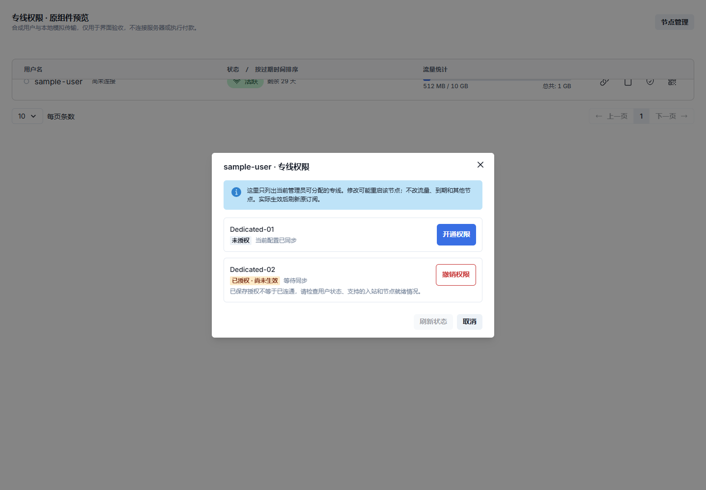
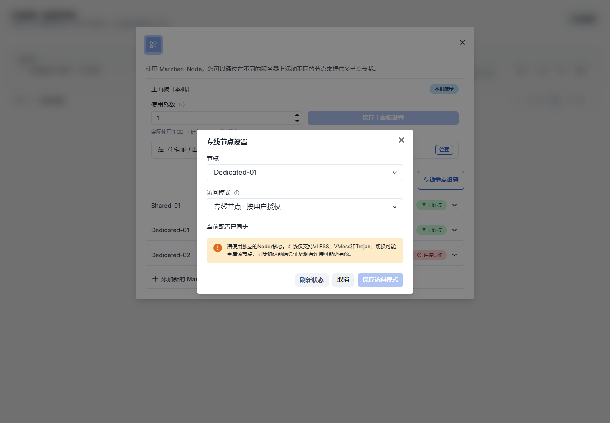

# 专线 Node 授权与通用网站 API

状态：本地开发与验证，尚未发布或部署。功能标识 `dedicated-node-access-v1`。本页是接口合同，不是已经上线的承诺。

机器可读的最小合同见[dedicated-node-access-v1.json](contracts/dedicated-node-access-v1.json)，回归测试核对其接口与实际 OpenAPI 一致。

## 当前入口与配置顺序

当前是**本地实现，未发布**：主控API和原 React/Chakra 管理入口已实现；下面是发布后供管理员/网站服务端采用的流程，不是要求现在对生产执行。真实服务器与上线状态见对应发布记录。

### 面板操作入口

- **新建专线**：在原“添加新的 Marzban 节点”表单选择“专线节点 · 按用户授权”，创建时即使用受限模式。旧节点默认公共；其原有证书、端口、住宅出口、中转、倍率及编辑区域不变。
- **已有节点模式**：节点管理弹窗内、原节点列表上方的“专线节点设置”，仅超级管理员可见。选择节点后读取当前模式；转换需要勾选确认，保存可能重启目标 Node。恢复公共必须明确确认开放范围。
- **用户权限**：用户列表操作区的盾牌按钮，手机展开用户行后的按钮，或编辑用户弹窗底部的同一入口。弹窗只列出当前管理员可分配的专线，逐项开通或撤销；不附带修改套餐、清零用量或刷新订阅凭证的操作。
- **管理员委派**：本版仍使用下面的 sudo API，不新增管理员委派界面。普通管理员需同时拥有用户归属与该专线分配权限。

弹窗沿用原 Chakra 组件、主题、打开/关闭和保存反馈；系统要求减少动态效果时不播放新增弹窗缩放。说明放在信息图标悬停/聚焦提示里。

### 保存、等待与恢复

“已授权 · 尚未生效”不等于已经连通；需要读取到实际生效状态。离线/待同步时保留原请求编号，使用“查询回执”执行只读查询；“续办原请求”需再次确认，仍使用同一个编号，不自动重发写请求。

面板在发送前将编号保存在当前浏览器标签页的 sessionStorage，按管理员、用户和 Node 隔离，刷新或关闭重开弹窗可继续查询；关闭标签页或清理存储不保证保留编号。请求不明时应保存显示的编号并先查询回执，不能换新编号盲目重发。存储不可用时阻止新写请求。网站对接必须将操作 UUID 持久化在自己的服务端订单/权益记录，不能依赖面板浏览器存储。

读取失败时不显示可开通操作；节点模式保存结果不明时须先刷新确认当前状态。涉及已有公共节点转专线时，仍需遵守下文维护窗口与独立核心要求。

### 通用网站流程

“普通 / 专线”在主控添加 Node 时选择，不是服务器安装两套不同程序。新服务器先安装配对 Node，再在主控创建记录时选择模式；不要先以公共模式连接、向全部用户下发后再改专线。已有节点升级保持原来的公共模式，不会自动变成专线。为避免配置冲突，服务器安装脚本不维护另一份独立授权开关。

1. 超级管理员通过`POST /api/node`在首次连接前建立`access_mode=restricted`的独立Node；已有公共节点转换须按本页维护窗口要求处理。
2. 超管为网站专用非sudo管理员委派允许分配的Node；确认目标用户属于该管理员。网站管理员Token只保存在服务端。
3. 网站后台调用`GET /api/dedicated-nodes`读取可分配目录，把稳定Node ID映射到自己的商品；是否向访客展示及如何定价由网站决定。
4. 网站自己核实付款和权益，先持久化操作UUID，再PUT开通；收到202只表示等待同步，不向用户承诺已经可用。
5. 查询用户/Node状态或操作回执，确认`granted=true`且`effective=true`；客户端刷新原订阅，不需要新建另一套用户或重置套餐。
6. 专线权益结束时用另一枚已保存的UUID提交DELETE，再查询`granted=false`且`sync_state=synced`。超时按回执流程处理，不盲目换UUID重试；有其他有效订单时由网站先合并权益，不直接撤销。

原本的子节点出口、中转、使用系数和用户套餐设置不作为专线授权入口；主控可以继续管理受限Node。完整权限、请求字段和失败边界见以下章节。

### 多用户、多专线示例

| 用户 | 授权线路 | 订阅中的专线 |
| --- | --- | --- |
| A | 线路1、线路2 | 仅线路1、线路2 |
| B | 线路1 | 仅线路1 |
| C | 线路1、线路2、线路3 | 三条全部显示 |

公共节点仍按原入站规则显示。撤销 A 的线路2并同步后，A 刷新原订阅会移除该线路，B/C不变；服务端同样移除 A 的目标节点凭证。订阅隐藏与实际连接拒绝分别验证，已授权用户主动分享自己的有效凭证并不属于本功能能防止的情况。

### 实际组件截图

以下使用合成用户/节点演示原组件，不包含生产账号、付款或真实连接结果：





## 分工与安全边界

网站自行管理展示名称、价格、商品、付款核实、订单及售后。主控只提供可授权专线列表、用户授权/撤销和运行时生效状态。`external_reference` 只是网站自己的订单/权益参考，不是付款证明；主控信任已获授权的管理员，不查询支付平台、不扣款、不修改订单。管理员 Token 只能存网站服务端，禁止放浏览器、公开页面、URL 或日志。

普通用户仍使用原订阅链接。授权不改变用户 UUID/密码、流量额度、已用流量、套餐到期、倍率、设备额度或周期重置；用户停用、过期、超额仍不能使用。授权没有独立到期时间，网站需要按自己的专线权益期限调用撤销；不得为了开通专线调用 reset/revoke_sub 或清空用户流量。

## Node 设置

超级管理员使用原 `POST /api/node`，新增可选字段：

```json
{"name":"Dedicated-A","address":"node.example.com","port":62050,"api_port":62051,"access_mode":"restricted","add_as_new_host":true,"usage_coefficient":1}
```

`access_mode` 为 `public`（旧客户端默认，所有原节点升级后保持原行为）或 `restricted`。**新专线必须在首次连接前创建为 restricted**；没有授权时不下发任何业务用户。主控仍能监控、管理出口和重连，不需要第二套面板。

`GET /api/node/{node_id}/access` 读取模式及同步状态；sudo-only `PUT` 同一路径提交 `{"access_mode":"restricted"}`，或提交 `{"access_mode":"public","confirm_public_access":true}` 显式恢复公共。切为公共会开放给原来具备对应入站权限的用户，不会覆盖其停用/过期状态。不能在不可达的公共 Node 上宣称限制已生效；已有公共节点改专线涉及目标 Node 重启，应在维护窗口排空连接，确认 `sync_state=synced` 后才按专线使用。未确认时原凭证/既有连接可能继续有效。

每台专线使用独立的 Node/Xray 核心，不能把同一个核心重复登记为公共和专线，不能与另一主控同时管理。已知重复地址会被拒绝，不通过 DNS 解析猜测别名；部署者仍须确认不同域名没有指向同一核心。主控证书、控制/API 端口、Xray v26.3.27 均不变。

首版专线业务协议为 **VLESS、VMess、Trojan**。为防止共享密码/无鉴权入口绕过，专线配置不保留其他业务入站或手写静态用户；Shadowsocks、SOCKS/HTTP 无鉴权入口等不对专线开放。公共 Node 的原有协议和配置不变。只有数据库中的已授权、可用用户及其当前有效设备凭证会进入专线配置。

## 网站专用管理身份与最小权限

沿用 `POST /api/admin/token` 获取 Bearer Token。建议为网站创建**非 sudo** 的独立管理员，并让其管理对应用户；不能给网站直接使用超级管理员 Token。

超级管理员先配置该网站管理员可以分配哪些专线：

| 方法 | 完整路径 | 用途 |
| --- | --- | --- |
| GET | `/api/admin/{admin_username}/dedicated-nodes` | 查询管理员可分配 Node ID |
| PUT | `/api/admin/{admin_username}/dedicated-nodes/{node_id}` | 允许分配此专线，可重复调用 |
| DELETE | `/api/admin/{admin_username}/dedicated-nodes/{node_id}` | 撤销分配能力，不自动撤销此前用户权益 |

以上三个接口仅 sudo 可调用。普通管理员必须同时满足**用户属于自己**和**被允许分配该 Node**；知道 Node ID 或操作 UUID 不会取得权限。撤销委派后无法继续开通/撤销该节点用户权限，遗留用户可由超管接管处理。

## 网站调用的接口

以下均要求 `Authorization: Bearer <网站管理员Token>`。GET 没有授权副作用，不触发重启或恢复操作。成功结果 `Cache-Control: no-store`。

| 方法 | 完整路径 | 用途 |
| --- | --- | --- |
| GET | `/api/dedicated-nodes` | 获取此管理员可分配的专线列表 |
| GET | `/api/user/{username}/dedicated-nodes` | 查询该用户在可分配专线上的授权/生效情况 |
| GET | `/api/user/{username}/dedicated-nodes/{node_id}` | 查询单个用户/专线的最新状态 |
| PUT | `/api/user/{username}/dedicated-nodes/{node_id}` | 开通，携带下述 JSON |
| DELETE | `/api/user/{username}/dedicated-nodes/{node_id}` | 撤销，也携带下述 JSON body |
| GET | `/api/dedicated-node-operations/{operation_id}` | 查询已持久化请求的回执和当前状态 |

列表返回 `capability` 和 `nodes`；每条包含 `id/name/enabled/status/supported_protocols/policy_revision/applied_revision/sync_state`。**不返回服务器地址、控制端口、证书、代理密码、用户凭据**。网站可将返回的稳定 Node ID 绑定自己的商品，用自己的价格/介绍上架；不要使用节点名称或客户端的地址字符串作为授权主键。

开通或撤销的请求：

```json
{"operation_id":"6ab035de-89b5-46e9-a8f9-c7474334a6ac","external_reference":"site-order-example"}
```

`operation_id` 必填、规范小写 UUID。网站须在自己的订单/权益记录中**先保存操作 UUID，再发送请求**。`external_reference` 可省略，长度1–128；不应放密码、客户隐私或整个支付回执。额外字段（例如 `paid`、`data_limit`、`expire`）拒绝422，授权接口不能被用作改套餐或证明付款。

响应例：

```json
{"node_id":3,"username":"example_user","granted":true,"effective":true,"sync_state":"synced","policy_revision":2,"applied_revision":2,"operation_id":"6ab035de-89b5-46e9-a8f9-c7474334a6ac","requested_granted":true,"external_reference":"site-order-example","detail":null}
```

- `granted`：当前数据库权益，和历史请求的 `requested_granted` 分开。
- `effective`：当前获授权、账号可用、有已启用的受支持入站、Node 就绪且此修订已确认。无支持协议或用户停用/过期/超额时可保存权益，但不会显示实际可用。
- `sync_state=synced`：目标 Node 对当前修订的配置应用和核心就绪已确认；不是“数据库保存了就算开通”。HTTP200。
- `pending/error`：权益已持久化，但 Node 离线、未就绪或应用响应不确定。HTTP202，网站应显示“待开通/待撤销”或“同步待确认”，不能显示已生效。
- 节点重启、主控进程重启后重新从数据库构建授权；ACK 不持久化为永久信任。断连会令 `effective=false`，重连以最新名单替换。
- 开通/撤销可能重启**目标 Node**业务核心，短暂影响这个 Node 上的已有连接；不会重启主控或其他 Node。既有长连接不承诺零中断或在未确认撤销时立即断开。

## 幂等、超时与恢复

同 UUID、同管理员、同用户、同 Node、同动作、同参考重复请求只记录一次；修改任一内容复用 UUID 返回409。重新用另一个 UUID 提交同一已生效权益不会重复增加权限或重置用量。旧开通请求在之后撤销后被重放，只读取原接受记录和**当前已撤销状态**，不会重新开通。

发生超时先 GET 原 `operation_id`。404不能证明在途请求绝不会提交，保留原 UUID；不能重新生成 UUID 盲目开通。必要时由网站显式续办同一个请求，服务端只向**最新**授权名单收敛，不重放旧名单。GET 回执本身不重启节点。用户删除重建后不会继承旧授权，旧操作不能授权给同名新用户。

建议网站状态：`已付款待开通 → 权限已保存待同步 → 已开通`，撤销为 `待撤销 → 已撤销`。付款成功、请求成功、Node实际生效是三件事。网站保留自己订单的锁、付款核验与幂等，不把面板的授权回执当成付款回执。

同一用户在同一 Node 上是一个布尔使用权，不是按订单堆叠的余额。网站应合并自己的多笔有效权益；只有该用户在此 Node 已无任何有效权益时才撤销，不能因一笔订单退款而机械撤销另一笔仍有效的专线权益。

## 错误与人工处理

| 状态码 | 常见 code/原因 | 处理 |
| --- | --- | --- |
| 401 | 无有效管理员 Token | 网站后端重新认证，不把 Token 交给用户 |
| 403 | `USER_FORBIDDEN` / `NODE_ALLOCATION_FORBIDDEN` | 检查用户归属、超管委派，不升级为超管绕过 |
| 404 | `USER_NOT_FOUND` / `NODE_NOT_FOUND` / `OPERATION_NOT_FOUND` | 核对后台绑定；未知请求保留原 UUID |
| 409 | `NODE_IS_NOT_DEDICATED` / `OPERATION_PAYLOAD_MISMATCH` / `USER_IDENTITY_CHANGED` | 停止盲重试，人工核对 |
| 409 | `CONFIRM_PUBLIC_ACCESS_REQUIRED` / `CONNECT_PUBLIC_NODE_BEFORE_RESTRICTING` / `REMOVE_SHARED_RELAYS_BEFORE_RESTRICTING` | 维护窗口处理 Node 模式/中转，不绕过保护 |
| 409/422 | `DEDICATED_NODE_REQUIRES_DISTINCT_CORE` / `NODE_ACCESS_DESTINATION_CONFLICT` | 不把同一个核心登记为公共与专线 |
| 422 | UUID、参考或请求字段不合法 | 修正请求，不改用户套餐 |
| 503 | `DEDICATED_ACCESS_UNAVAILABLE` | 保留操作 UUID，检查主控数据库/日志 |

## 订阅 Hosts 与透明中转

新增 Node 的自动 Host 写入显式 `node_id`，订阅先按用户权限过滤再输出各格式。升级只给唯一、精确匹配旧地址的 Host 回填所属节点；不猜测别名、逗号地址或 DNS。手工别名请由超管通过原 `PUT /api/hosts` 为对应 Host 设置 `node_id`，修改 Host 时必须保留全部原字段。无法确定所属的旧专线端点默认隐藏，不依赖匹配域名字符串来授予权限。

中转保留目标 Node ID，权限按**目标**而非中转入口地址判断，不能因走公共中转入口获得专线权限。首版禁止专线 Node 担任公共共享中转源；先移除其源中转配置再切换为专线。专线所指的是逻辑访问受限，不代表运营商物理专线、独享带宽或防止已授权用户主动共享凭证。

## 调用示例

```bash
# Token 与账号绑定保存在网站服务端；示例不会执行任何付款。
curl --fail-with-body -H "Authorization: Bearer $MARZBAN_TOKEN" \
  https://panel.example.com/api/dedicated-nodes

curl --fail-with-body -X PUT \
  -H "Authorization: Bearer $MARZBAN_TOKEN" -H 'Content-Type: application/json' \
  --data '{"operation_id":"6ab035de-89b5-46e9-a8f9-c7474334a6ac","external_reference":"site-order-example"}' \
  https://panel.example.com/api/user/example_user/dedicated-nodes/3

curl --fail-with-body -H "Authorization: Bearer $MARZBAN_TOKEN" \
  https://panel.example.com/api/dedicated-node-operations/6ab035de-89b5-46e9-a8f9-c7474334a6ac
```

撤销用 DELETE 和一枚**另行持久化的撤销 UUID**。Python标准库后端示例见 [DedicatedAccessClient](../examples/dedicated_access_client.py)：HTTPS校验、不跟随携带Token的重定向、不自动重试、更不处理支付。开发者可用其他语言按相同 HTTP 合同接入。OpenAPI 以部署后的 `/openapi.json` 为准；旧版本没有本能力，网站应先验证 `capability`。

## 升级与回退

迁移 `c345de67fa89 → d456ef78ab90` 新增授权、委派、接受审计表及 Node/Host 元数据；旧节点保持 public，不改原地址、端口、证书、用户账目。主控实现过滤，Node 与 scripts 本轮没有运行时或线协议变化；仍须使用能够接受原完整Xray配置并确认核心/API就绪的配对 Node。

已有安装走停写备份和 update，不重装、不删卷。先完成发布/镜像核验再由用户升级；本次未执行生产更新。存在 restricted Node 或任何授权操作审计时拒绝 downgrade，避免旧程序向专线恢复全量用户；不能删除审计绕过。审计与授权状态应随数据库备份一起保存。

当前仅支持与原透明中转相同的**单活主控 worker**配置。HTTP+SQLite/WAL 与本机真实核心测试不等于多进程/多主控并发、真实跨服务器 REST/RPyC 或支付平台验收。测试/剩余事项见[本地验证记录](releases/dedicated-node-access-20261030.md)。
